# 🤖 Lab Ansible: WordPress em Ubuntu e CentOS Stream 10


Provisionamento automatizado de um servidor web com **Apache, MariaDB, PHP e WordPress** em duas distribuições Linux diferentes, a partir de um único playbook Ansible.

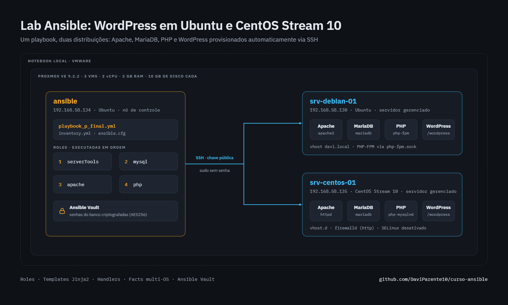

---

## 📑 Sumário

- [O que é o Ansible](#-o-que-é-o-ansible)
- [Objetivo do projeto](#-objetivo-do-projeto)
- [Ambiente do laboratório](#️-ambiente-do-laboratório)
- [Preparação dos servidores gerenciados](#-preparação-dos-servidores-gerenciados)
- [Preparação da máquina de controle](#-preparação-da-máquina-de-controle)
- [Estrutura do projeto](#-estrutura-do-projeto)
- [Roles](#-roles)
- [Execução do playbook](#️-execução-do-playbook)
- [Verificação dos servidores](#-verificação-dos-servidores)
- [Segurança das credenciais](#-segurança-das-credenciais)
- [Resultado](#-resultado)
- [Adaptações em relação ao curso](#️-adaptações-em-relação-ao-curso)

---

## 🧠 O que é o Ansible

O **Ansible** é uma ferramenta de **infraestrutura como código (IaC)** que permite automatizar a configuração de servidores, a instalação de softwares e a implantação de aplicações a partir de arquivos de texto. Em vez de acessar cada máquina e executar comandos manualmente, você descreve em arquivos YAML como o servidor deve ficar, e o Ansible se encarrega de deixá-lo nesse estado.

Duas características importantes:

- **Sem agente:** não é preciso instalar nada nos servidores gerenciados. A máquina de controle se conecta a eles via SSH e executa as tarefas usando o Python já presente nos servidores.
- **Idempotência:** se um servidor já estiver no estado desejado, o Ansible não altera nada. Por isso, o mesmo playbook pode ser executado várias vezes com segurança.

---

## 🎯 Objetivo do projeto

Automatizar, a partir de um **único playbook**, a preparação completa de dois servidores com distribuições Linux diferentes (**Ubuntu** e **CentOS Stream 10**) até deixá-los prontos para a instalação do WordPress.

O playbook instala e configura o banco de dados MariaDB, o servidor web Apache e o PHP, além de criar o site e baixar o WordPress, **identificando automaticamente a distribuição de cada servidor** para aplicar os comandos corretos.

O projeto foi desenvolvido como laboratório de estudo, com base em um curso de Ansible do canal Mario Santana (https://www.youtube.com/watch?v=Os0Uo5VXxNU&list=PLORF-y_edVoDQnky9u2OgyrfirE1dhutX).

---

## 🖥️ Ambiente do laboratório

Todo o ambiente roda localmente no meu notebook. Instalei o **Proxmox Virtual Environment 9.2.2** dentro do **VMware** e, no Proxmox, criei três máquinas virtuais:

| IP | Hostname | Sistema | Função |
|---|---|---|---|
| 192.168.58.134 | `ansible` | Ubuntu | Máquina de controle (onde o Ansible roda) |
| 192.168.58.130 | `srv-debian-01` | Ubuntu | Servidor gerenciado 1 |
| 192.168.58.135 | `srv-centos-01` | CentOS Stream 10 | Servidor gerenciado 2 |

Cada máquina virtual tem **10 GB de disco, 2 GB de memória RAM e 2 núcleos de processador**.

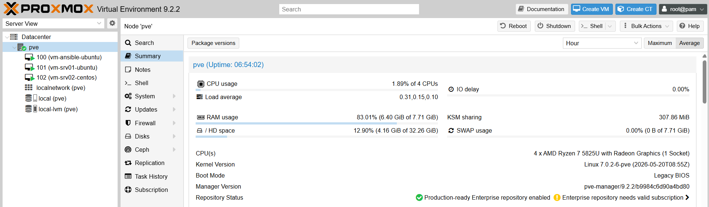
*Painel do Proxmox com as três máquinas virtuais em execução.*

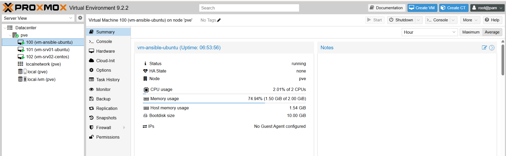
*Configuração de hardware de uma das VMs.*

---

## 🔧 Preparação dos servidores gerenciados

Antes de usar o Ansible, acessei os dois servidores para atualizá-los para a versão mais recente de cada distribuição e para dar permissão de administrador (sudo) ao meu usuário **sem necessidade de senha**. Assim, o Ansible consegue executar tarefas administrativas sem interromper a execução pedindo senha.

### CentOS Stream 10 (como root)

```bash
yum update
yum install sudo
usermod -aG wheel davi
vi /etc/sudoers
```

No final do arquivo `sudoers`, adicionei a linha:

```
davi ALL=(ALL:ALL) NOPASSWD:ALL
```

### Ubuntu (como root)

```bash
apt update
apt upgrade -y
usermod -aG sudo davi
visudo
```

No final do arquivo `sudoers`, adicionei a mesma linha:

```
davi ALL=(ALL:ALL) NOPASSWD:ALL
```

> 💡 No Ubuntu o `sudo` já vem instalado, e o grupo de administradores se chama `sudo`. No CentOS, ele se chama `wheel`.

> ⚠️ A permissão de sudo sem senha foi usada por se tratar de um **ambiente de laboratório**. Em produção, o recomendado é restringir essa permissão ou informar a senha do sudo durante a execução do playbook (`--ask-become-pass`).

---

## 🔑 Preparação da máquina de controle

Na máquina do Ansible, configurei o acesso por chave SSH aos dois servidores e instalei o Ansible:

**1. Gerar um par de chaves SSH**

```bash
ssh-keygen
```

**2. Copiar a chave pública para os dois servidores**

```bash
ssh-copy-id davi@192.168.58.130
ssh-copy-id davi@192.168.58.135
```

**3. Instalar o Ansible**

```bash
sudo apt install ansible
```

A chave SSH funciona como uma "chave de acesso" da máquina de controle: depois de copiada para os servidores, eles reconhecem a máquina do Ansible e liberam o acesso sem senha.

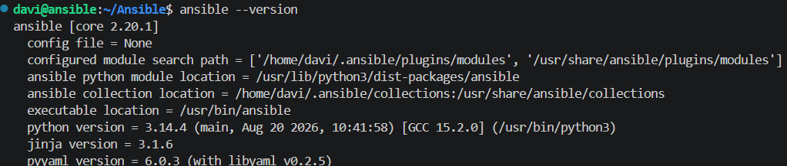
*Versão do Ansible instalada na máquina de controle.*

Para confirmar a comunicação com os servidores:

```bash
ansible all -m ping
```

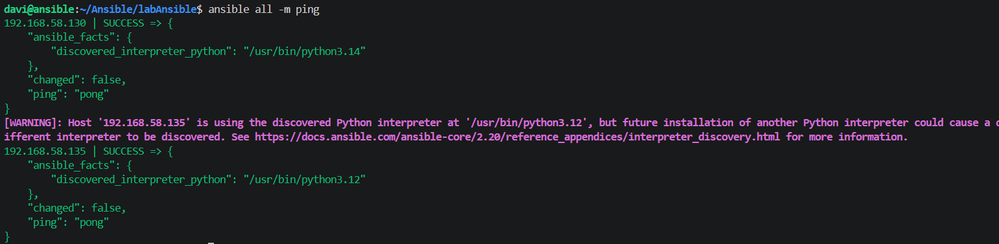
*Os dois servidores respondendo `pong`: a máquina de controle consegue se conectar e executar tarefas neles.*

---

## 📁 Estrutura do projeto

```
labAnsible/
├── ansible.cfg
├── inventory.yml
├── playbook_p_final.yml
├── anotacao1.yml
├── anotacao2.yml
├── imagens/
└── roles/
    ├── serverTools/
    ├── mysql/
    ├── apache/
    └── php/
```

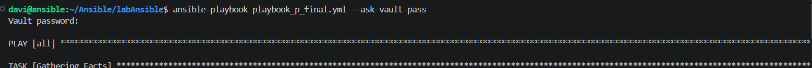
*Projeto aberto no VS Code, conectado à máquina de controle via SSH.*

| Arquivo / pasta | Função |
|---|---|
| `ansible.cfg` | Configuração do Ansible para este projeto, com comportamentos padrão (como qual inventário usar), para não precisar informá-los a cada execução. |
| `inventory.yml` | Lista dos servidores gerenciados, organizados nos grupos `centos` e `ubuntu`. Para cada servidor, define a variável `hostname`, usada para configurar o nome da máquina. |
| `playbook_p_final.yml` | Playbook principal. Executa em todos os servidores, ativa o modo administrador (`become`) e chama as roles na ordem: `serverTools`, `mysql`, `apache` e `php`. |
| `anotacao1.yml` / `anotacao2.yml` | Anotações de estudo feitas durante o curso. |
| `imagens/` | Prints usados neste README. |
| `roles/` | Cada role é um "módulo" do projeto, responsável por uma parte da instalação. Isso deixa o código organizado e permite reaproveitar cada parte em outros projetos. |

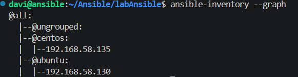
*Inventário visualizado com `ansible-inventory --graph`: os servidores organizados por grupo.*

### Estrutura de uma role

As roles foram criadas com o comando `ansible-galaxy init`, que gera uma estrutura padrão:

| Pasta | Conteúdo |
|---|---|
| `tasks/` | As tarefas que a role executa. O `main.yml` é o ponto de entrada. |
| `handlers/` | Tarefas que só rodam quando acionadas por outra tarefa que alterou algo (por exemplo, reiniciar o Apache depois de mudar sua configuração). |
| `templates/` | Modelos de arquivos de configuração com variáveis, preenchidos pelo Ansible antes de serem enviados ao servidor. |
| `files/` | Arquivos copiados para o servidor sem alteração. |
| `vars/` | Variáveis da role, com prioridade alta. |
| `defaults/` | Valores padrão das variáveis, com prioridade baixa e fáceis de sobrescrever. |
| `meta/` | Informações sobre a role, como autor, descrição e dependências. |
| `tests/` | Inventário e playbook de exemplo para testar a role isoladamente. |

---

## 🧩 Roles

**🛠️ serverTools**
Prepara a base dos servidores: define o nome da máquina, instala ferramentas úteis para administração e, no CentOS, libera o tráfego HTTP no firewall e desativa o SELinux.

**🗄️ mysql**
Instala e inicia o MariaDB, cria o banco de dados e o usuário do WordPress e remove as contas anônimas do banco.

**🌐 apache**
Instala o Apache (`apache2` no Ubuntu e `httpd` no CentOS). O `tasks/main.yml` identifica a distribuição do servidor e carrega o arquivo de tarefas correspondente (`debian.yml` ou `redhat.yml`):

```yaml
- name: Inclui tarefas para RedHat
  ansible.builtin.include_tasks: redhat.yml
  when: ansible_facts['os_family'] == "RedHat"

- name: Inclui tarefas para Debian
  ansible.builtin.include_tasks: debian.yml
  when: ansible_facts['os_family'] == "Debian"
```

A role cria o site (virtual host) a partir de um template e, por meio de handlers, adiciona o domínio ao arquivo `hosts`, reinicia o Apache, baixa o WordPress e ajusta as permissões da pasta do site.

**🐘 php**
Instala o PHP e as extensões necessárias para o WordPress. No Ubuntu, o PHP roda como um serviço separado (**PHP-FPM**), e o Apache repassa as páginas PHP para ele.

---

## ▶️ Execução do playbook

```bash
ansible-playbook playbook_p_final.yml --ask-vault-pass
```

O `--ask-vault-pass` pede a senha do cofre do Ansible Vault, onde estão as credenciais do banco (veja [Segurança das credenciais](#-segurança-das-credenciais)).

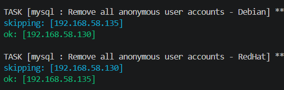
*O playbook decide sozinho o que fazer em cada servidor: tarefas específicas de uma distribuição aparecem como `skipping` no outro servidor.*

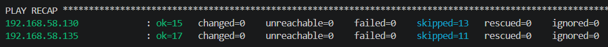
*Resumo da execução (`PLAY RECAP`) com `failed=0` e `unreachable=0` nos dois servidores.*

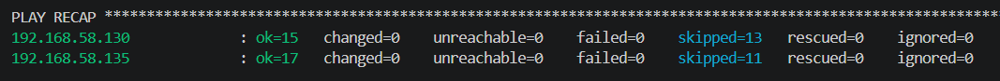
*Idempotência na prática: executando novamente, com tudo já configurado, o Ansible não altera nada (`changed=0`).*

---

## 🔍 Verificação dos servidores

Além de rodar playbooks, o Ansible permite executar comandos avulsos em vários servidores ao mesmo tempo. Para conferir o nome e o sistema de cada máquina:

```bash
ansible all -a "hostnamectl"
```

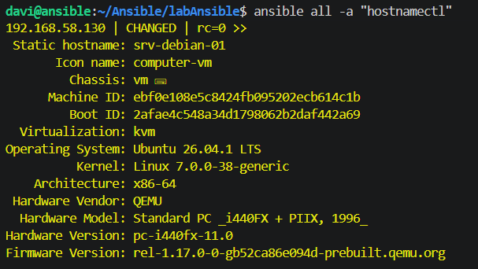

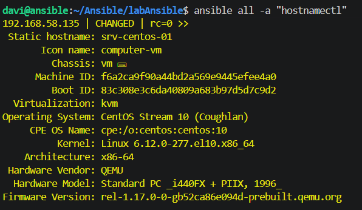
*Os dois servidores com o hostname definido pelo playbook (`srv-debian-01` e `srv-centos-01`).*

---

## 🔐 Segurança das credenciais

As senhas do banco de dados ficam no arquivo `roles/mysql/vars/main.yml`, protegido com o **Ansible Vault**. O arquivo é armazenado **criptografado** no repositório:

```
$ANSIBLE_VAULT;1.1;AES256
6638343664316637346631623931393565333...
```

Só é possível lê-lo ou executar o playbook informando a senha do cofre. Comandos úteis:

| Comando | O que faz |
|---|---|
| `ansible-vault encrypt arquivo.yml` | Protege um arquivo |
| `ansible-vault view arquivo.yml` | Mostra o conteúdo sem alterar |
| `ansible-vault edit arquivo.yml` | Edita e protege novamente ao salvar |
| `ansible-vault decrypt arquivo.yml` | Remove a proteção |

> 💡 Para executar este projeto no seu ambiente, crie o seu próprio `roles/mysql/vars/main.yml` com as variáveis do banco (como `db_wp_password`) e, se quiser, proteja-o com `ansible-vault encrypt`.

---

## 🌐 Resultado

Ao final da execução, os dois servidores ficam com Apache, MariaDB e PHP configurados e com o WordPress funcionando.

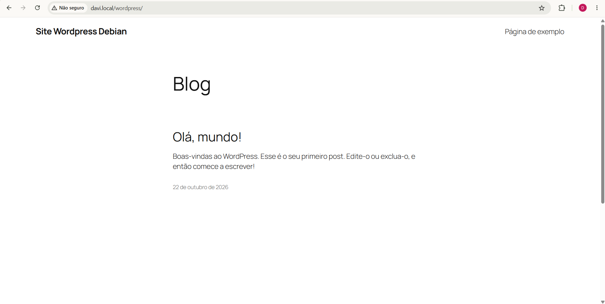
*WordPress rodando no servidor Ubuntu.*

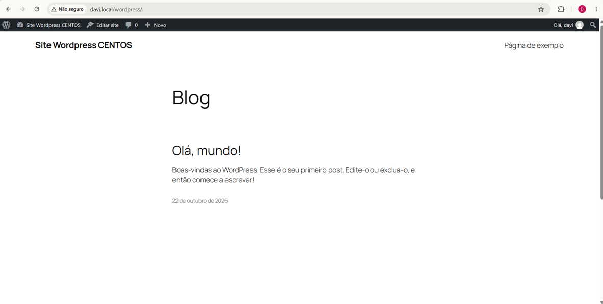
*WordPress rodando no servidor CentOS Stream 10.*

